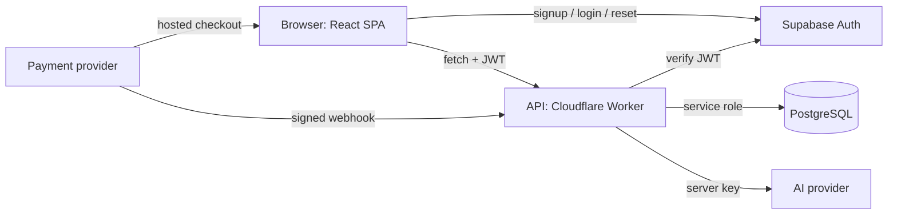

# Architecture

## The shape of the product

QuickBiz Studio is one product made of three deployables:

1. **Web app** (`apps/web`) - a React single-page application served as static files.
2. **API** (`apps/api`) - a Cloudflare Worker that owns every decision about money,
   AI usage and user data.
3. **Database** (`supabase/`) - PostgreSQL with Supabase Auth attached.

The browser never talks to the database tables that hold credits or payments.
It talks to the API. The API holds the service-role database key.



## Why this shape

- **Money and AI are server-authoritative.** A user cannot change a price, a credit
  balance or a result by editing a request in their browser.
- **One API deployable.** A modular monolith keeps free-tier limits manageable and
  makes debugging possible for a small team. Modules are separated by folder and
  by service boundaries, not by network calls.
- **Static frontend.** Pages are cheap to serve, cache well on mobile networks and
  do not need a Node server.
- **Edge runtime.** Workers are always awake, which matters for webhooks and for
  the first visitor after a quiet period. Free spinning-down Node hosts were rejected
  for that reason.

## Approved stack

| Layer | Choice |
|---|---|
| Language | TypeScript everywhere |
| UI | React + Vite + Tailwind CSS + Radix primitives |
| Routing | React Router |
| Server state | TanStack Query |
| Forms | React Hook Form + Zod |
| API | Hono on Cloudflare Workers |
| Database | PostgreSQL (Supabase) |
| Auth | Supabase Auth |
| Validation | Zod, shared between web and API |
| AI | Provider adapter (Gemini first, subject to approval) |
| Hosting | Cloudflare Pages (web), Cloudflare Workers (API) |
| Source control | GitHub, pnpm monorepo |

Changing any of these requires a written technical reason and owner approval.

## Repository layout

```
apps/web        React SPA (Cloudflare Pages)
apps/api        Worker API (Cloudflare Workers)
packages/shared TypeScript types, Zod schemas, tool catalogue, formatters
packages/config Shared TypeScript tsconfig bases
supabase        SQL migrations and database notes
docs            This documentation set
.github         CI workflow
```

## Boundaries that must not move

1. **Credit cost is server truth.** `tool_catalog` / the shared catalogue decides
   price. The UI only displays what the server says and confirms before submit.
2. **Purchased credits never expire.** Free credits may expire (disclosed). Purchased
   credits carry `expires_at = NULL` at the database level.
3. **No fabricated AI output.** If a provider is not configured, the feature reports
   that honestly. There is no canned "AI" text anywhere in the codebase.
4. **No secrets in the browser bundle.** Only `VITE_*` values reach the client, and
   they are public by definition.
5. **Failures are visible.** Every async surface has loading, empty, error and success
   states. Errors return a stable code, a human message and a request id.

## Data flow for a paid AI action (Stage 6 target)

1. Browser sends `{ toolSlug, input, idempotencyKey }`.
2. API validates the payload with the shared Zod schema.
3. API reserves credits atomically (row lock + ledger row).
4. API calls the provider adapter with the server-side key.
5. On success: ledger settles, usage row saved, result returned.
6. On technical failure: compensating ledger row returns the credits automatically.

Detailed rules live in [07-ai-integration.md](./07-ai-integration.md) and
[05-database.md](./05-database.md).

## Environments

| Environment | Frontend | API | Database |
|---|---|---|---|
| Local | `vite` on :5173 | `wrangler dev` on :8787 | hosted free project or none |
| Preview | Pages preview URL | Worker preview (optional) | preview project (Stage 5+) |
| Production | Pages production | Worker production | production project |
