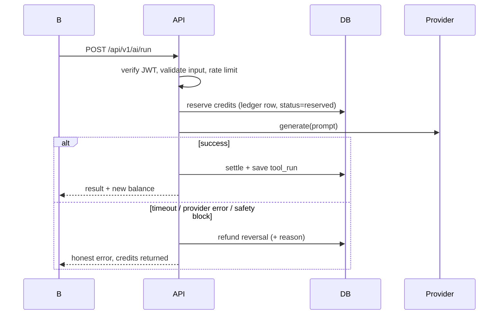

# AI integration strategy

## Non-negotiables

1. Every AI result is a real provider response. No canned text is ever presented as
   AI output.
2. Provider keys exist only as Worker secrets.
3. The provider is swappable through an adapter; tools never import a vendor SDK.
4. Credits are reserved before the call and returned automatically on technical failure.
5. No paid AI account is activated without the owner's explicit approval.

## Contract

`apps/api/src/ai/provider.ts` defines:

```ts
interface AiProvider {
  id: string;
  label: string;
  defaultModel: string;
  isConfigured(): boolean;
  generate(request: AiGenerationRequest): Promise<AiGenerationResult>;
}
```

`ProviderRegistry` holds registered providers. In Stage 2 the registry is empty on
purpose: nothing can generate, so nothing can pretend to.

## Planned adapters

| Adapter | Stage | Notes |
|---|---|---|
| Gemini (Google AI Studio) | 6 | Free tier for development; terms and data-use disclosure must be reviewed |
| OpenAI | later | Paid; requires owner approval |
| Anthropic | later | Paid; requires owner approval |
| OpenRouter | optional | Useful for model comparison in admin tooling |

Each adapter normalises: text output, token usage, model name, latency. Provider-specific
errors are mapped to `PROVIDER_ERROR` with a retry hint, never surfaced raw.

## Request lifecycle (Stage 6)



Reserving before calling prevents a user with one credit from firing ten parallel
requests. Reversal is what makes the "no charge for technical failures" promise real.

## Prompt design

- Prompts live in `apps/api/src/ai/prompts/<tool>.ts` with typed variables and a
  version string stored on the usage row.
- System instructions set language, tone, length and safety boundaries.
- Output length is capped per tool to keep cost predictable.
- Input length is capped and validated before the provider is called.
- User text is treated as data, never as instructions that can change credit or
  authorisation behaviour.

## Cost control

- Credits charged per tool come from the catalogue, not from provider pricing.
- Token usage is logged per run so a tool priced below its real cost is detectable.
- Admin can pause a tool by changing its status without a deploy.

## Honesty rules

- If no provider is configured, the tool UI says so and no credits are deducted.
- If a request is blocked by provider safety filters, the user is told plainly and
  credits are returned.
- Free-tier provider terms that allow training on inputs must be disclosed in the
  privacy policy before public launch, or the project moves to a no-training tier.
