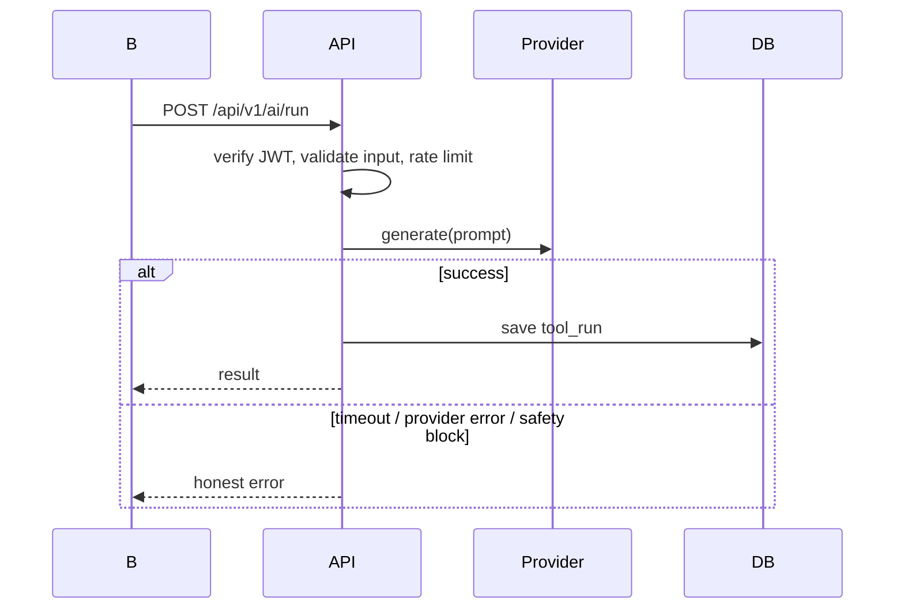

# AI integration strategy

## Non-negotiables

1. Every AI result is a real provider response. No canned text is ever presented as
   AI output.
2. Provider keys exist only as Worker secrets.
3. The provider is swappable through an adapter; tools never import a vendor SDK.
4. Credits will be reserved before the call and returned automatically on technical
   failure. That mechanism belongs to Stage 7 (decision D6); nothing in Stage 6
   charges or refunds.
5. No paid AI account is activated without the owner's explicit approval.

## Contract

`apps/api/src/ai/provider.ts` defines:

```ts
interface AiProvider {
  id: string;
  label: string;
  defaultModel: string;
  isConfigured(): boolean;
  generate(request: AiGenerationRequest): Promise<AiGenerationResult>;
}
```

`ProviderRegistry` holds registered providers. In Stage 2 the registry is empty on
purpose: nothing can generate, so nothing can pretend to. That is still true after
Stage 6 M0, which adds contracts and prompts but no adapter.

`GET /api/v1/ai/status` derives availability from this registry, not from
configuration. Naming `AI_PROVIDER` and `AI_MODEL` records a preference; with an empty
registry the endpoint keeps reporting `configured: false` and
`reason: "no-adapters-registered"`. See
[18-stage-6-ai-tools.md](./18-stage-6-ai-tools.md).

## Planned adapters

| Adapter | Stage | Notes |
|---|---|---|
| Provider choice deferred | 6+ | Owner has not approved a provider (decision D1). Gemini is one candidate, not a commitment. |
| OpenAI | later | Paid; requires owner approval |
| Anthropic | later | Paid; requires owner approval |
| OpenRouter | optional | Useful for model comparison in admin tooling |

Each adapter normalises: text output, token usage, model name, latency. Provider-specific
errors are mapped to `PROVIDER_ERROR` with a retry hint, never surfaced raw.

## Request lifecycle (once an adapter exists)



Credit reservation and automatic reversal are **not** part of this flow yet. They
arrive with the Stage 7 wallet (decision D6). Reserving before calling prevents a user
with one credit from firing ten parallel requests, which is why the order matters when
it is added.

## Prompt design

- Prompts live in `apps/api/src/ai/prompts/<tool>.ts` and are registered in
  `prompts/index.ts`. Each carries a version string; the versions are owned by
  `AI_PROMPT_VERSIONS` in shared code so a run cannot record a version that differs
  from the wording used.
- `buildUser` re-parses the input with the tool's schema, so a prompt cannot be built
  from invalid data.
- System instructions set language, tone, length and safety boundaries. They never
  contain user text.
- A test asserts that a pasted `</user_input>` is escaped and the data block has
  exactly one closing marker.
- Output length is capped per tool to keep cost predictable.
- Input length is capped and validated before the provider is called.
- User text is treated as data, never as instructions that can change credit or
  authorisation behaviour.

## Cost control

- Credits charged per tool come from the catalogue, not from provider pricing.
- Token usage is logged per run so a tool priced below its real cost is detectable.
- Admin can pause a tool by changing its status without a deploy.

## Honesty rules

- If no provider is configured, the tool UI says so and no credits are deducted.
  `/api/v1/ai/status` is the contract for that statement.
- If a request is blocked by provider safety filters, the user is told plainly. Once
  credits exist (Stage 7), they are returned.
- Free-tier provider terms that allow training on inputs must be disclosed in the
  privacy policy before public launch, or the project moves to a no-training tier.
